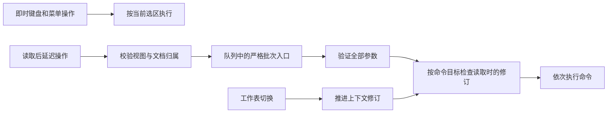

# 从Office使用痛点到Ely底层改进

调查日期：2026-10-25。依据为用户原始问题、微软官方技术资料及GitHub项目
自己的说明。社区问题是具体版本和平台上的定性样本，不代表用户总体占比，
历史已关闭问题也不当作当前全部Office版本仍有相同缺陷的证据。

## 优先级与架构落点

| 痛点与证据 | 对Ely的架构要求 | 当前处理 |
| --- | --- | --- |
| 用户报告保存后重开缺少修改；AutoSave涉及存储位置和同步状态。[原始反馈](https://learn.microsoft.com/en-us/answers/questions/5268052/microsoft-word-discarded-all-my-saved-changes-to-w)、[官方AutoSave说明](https://support.microsoft.com/en-us/word/turn-on-autosave) | 本地保存、恢复副本、云同步分清；成功状态来自落盘确认，冲突停止覆盖 | 沿用既有原子保存、外部修改检查和恢复保护；长期断电/同步冲突验收仍开放 |
| PowerPoint网页插件曾报告插入文字破坏先前撤销历史。[历史Issue3985](https://github.com/OfficeDev/office-js/issues/3985) | 命令应说明撤销能力；批量顺序执行不能冒充原子事务 | 保留现有内核撤销确认；后续逐类核对扩展命令，不宣称本轮实现统一事务撤销 |
| 当前选区会随用户操作变化，扩展需要稳定目标。微软提供区域绑定以脱离当前选区。[区域绑定](https://learn.microsoft.com/en-us/office/dev/add-ins/develop/bind-to-regions-in-a-document-or-spreadsheet) | 延迟命令绑定文档和读取时的状态；执行前拒绝过期目标 | 本轮落实：严格状态检查、视图与文档归属检查、切换工作表使旧状态失效；合并确认接入 |
| 微软排查Excel卡顿时要求检查加载项冲突。[官方排查文档](https://support.microsoft.com/en-us/excel/excel-not-responding-hangs-freezes-or-stops-working) | 扩展与界面/文档引擎分开；耗时工作可观察、可结束，不阻塞交互线程 | 保留独立worker、顺序输入队列及进程清理；第三方扩展权限与隔离运行时尚未实现 |
| 插件逐单元格读写、循环同步增加往返开销。[批处理建议](https://learn.microsoft.com/en-us/office/dev/add-ins/excel/performance)、[减少循环同步](https://learn.microsoft.com/en-us/office/dev/add-ins/concepts/correlated-objects-pattern) | 参数整批验证、保持顺序、快照只检查一次；后续按实测减少IPC往返 | 本轮统一严格批次入口；仍逐命令发送IPC，不声称减少为单帧、显著提速或回滚整个批次 |
| 用户报告同一Word文件在不同电脑上字号、分页和打印不同。[原始反馈](https://learn.microsoft.com/en-us/answers/questions/5329615/why-does-word-display-and-print-differently-on-dif) | 字体与排版环境可诊断；导入、显示、保存、重开、打印分别验收 | 继续保留既有字体/DPI/OOXML修复；缺字体提示和更多真实复杂文档视觉对照留待后续 |

保存和撤销会影响内容安全，先于功能数量；目标绑定是它们与未来自动化共用
的基础。本轮优先级是工程判断，不是根据差评数量做出的排名。

## GitHub扩展项目可借鉴的做法

| 项目与来源 | 借鉴内容 | Ely的适用边界 |
| --- | --- | --- |
| [xlwings](https://github.com/xlwings/xlwings/blob/main/README.rst) | Python自动化、数组/数据表互通、脚本与文档对象模型分层 | 可规划独立脚本接口；它的Excel集成不会因此直接兼容Ely，PRO目录也不视为同一开源授权范围 |
| [Rubberduck](https://github.com/rubberduck-vba/Rubberduck/blob/next/README.md) | 导航、静态检查、重构和可执行测试；项目自身提醒大规模分析会消耗内存 | 先建立可测试的命令契约和小范围分析，再考虑大型语言服务；本轮不嵌入VBA IDE |
| [Excel-DNA](https://github.com/Excel-DNA/ExcelDna)、[官方介绍](https://excel-dna.net/docs/introduction/) | 插件接口、异步工作、函数集成及宿主退出处理 | 参考生命周期和接口边界；不把Excel的COM/XLL加载机制直接接入Ely |

这些项目用于设计调研，未拷贝其源码、安装插件或执行其脚本。

## 本轮代码结构

原路径为界面排队 → `Input::Run` → `Worker::run_all`。即使调用方传了
读取时的 `Doc`，旧实现也只在命令带编号参数时发送 `EXPECT`；写单元格、
合并等选区命令会绕过检查。视图也没有拒绝属于其他文档的句柄，而切换
工作表未推进worker修订。这是本地源码检查后由真实worker对照复现的缺口，
不把它归因于Microsoft Office或这些开源项目。

新结构保持当前选区操作与读取后操作的语义：

- 将客户端命令调度和视图命令入口分别提取到各自的 `commands.rs`，
  使进程生命周期、画布绘制与命令契约分开；修改涉及的代码文件保持500行内。
- `run_all_at` 对非编号命令同样执行一次修订检查；普通输入继续使用当前选区。
  命令默认绑定选区，严格批次用 `EXPECT_AT` 检查完整上下文修订；批内只要有
  一条选区命令，就采用这项检查。仅显式指定幻灯片的 `notes.set` 标为文档目标，
  允许读取之后只有 `SHOW_SHEET` 翻页，仍写回原页；其他已计数输入、内容修改、
  页序变化及未来修订均拒绝。`TURN` 仍使它失效，不笼统豁免一切导航。
- `LokView` 拒绝不属于自身文档的读取句柄，不将它排入另一个视图的队列。
- `SHOW_SHEET` 推进上下文修订；它影响操作有效性，不等于把切换工作表记为文档编辑。
- 文字属性面板按命令参数区分即时修改与读取后操作，快速连续改段距、纸张、格式
  保持原队列顺序；编号引用仍走严格检查。
- 表格合并对话框保存来源 `Doc`，保留/移动按钮按同一来源状态执行；发生变化时
  复用已有中英文“文档已改变，请重试”提示，不静默改用新选区。
- 三应用测试复用弱引用退出回收，避免后台读取任务延长测试worker生命周期；
  保持严格的进程和内存保护，该辅助逻辑不进入正常产品构建。

协议新增 `EXPECT_AT=37`，应用和worker须配套更新；旧worker不认识该请求时
报错，不回退到不检查的执行路径。既有 `EXPECT` 检查最近非翻页输入是否晚于
快照，`REVISION` 仍返回完整修订，`Doc` 和该响应的编码未变。

批次参数错误在任何命令发送前返回。修订检查只在批次开始执行一次，执行时
持有现有worker互斥锁；这不能证明内核内部事件全局原子性。运行中某条命令
失败时，前面已成功的命令可能保留；统一事务回滚、第三方扩展权限、持久区域
绑定和完整插件SDK均未在本轮实现。

验证结果单独记录在本轮Windows验证文档，未通过前不把上述实现记作验收完成。
