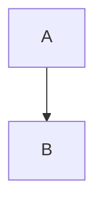

# Title

Text with $e^{i\pi} + 1 = 0$ inline and a note.[^1]

$$I = \int \rho R^{2} dV$$

- [x] done
- [ ] open

| a | b |
| - | - |
| 1 | 2 |

```rust
fn main() {}
```

$$
\int_0^1 x\,dx
$$

$$
\frac{1}{
$$



```mermaid
graph TD
  A -->
```

[^1]: The note.
